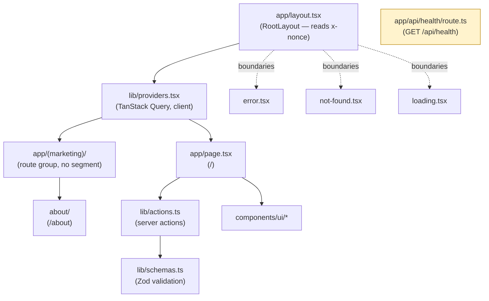
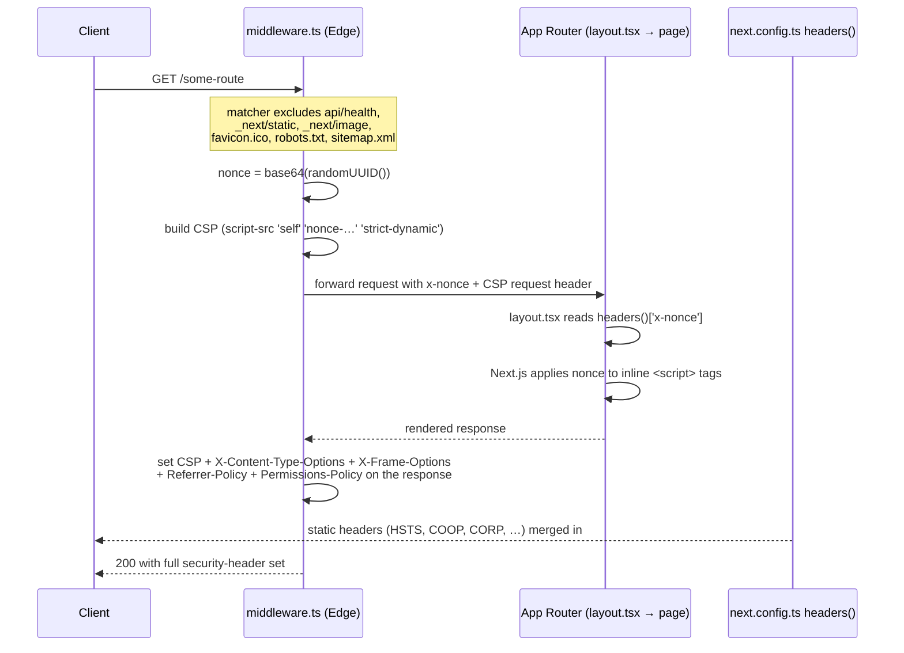
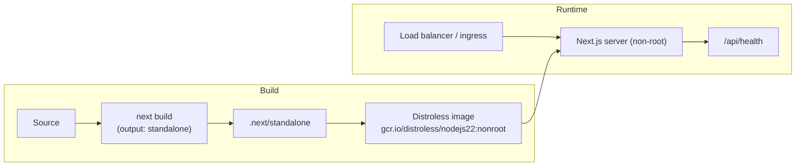

# Architecture

This document describes how the **Next.js 15 (App Router)** frontend is wired
together and how a request flows through the per-request CSP nonce and security
headers. It complements the code in `middleware.ts`, `next.config.ts`,
`app/layout.tsx`, and `env.ts`.

## App Router structure

```
app/
  layout.tsx              Root layout — reads the x-nonce header, mounts <Providers>
  page.tsx                Home route
  error.tsx               Route-segment error boundary
  not-found.tsx           404 boundary
  loading.tsx             Suspense fallback
  globals.css             Tailwind v4 entrypoint
  (marketing)/            Route group (no URL segment)
    about/                /about
  api/
    health/route.ts       GET /api/health — liveness/readiness (CSP-exempt)
components/ui/            Presentational primitives (Button, Card)
lib/                      utils, providers (TanStack Query), schemas (Zod), actions
middleware.ts            Per-request nonce CSP + early security headers
env.ts                   Zod-validated public/server env (t3-env style)
next.config.ts           standalone output, image allowlist, static headers
```



`app/api/health` is excluded from the middleware matcher (see `middleware.ts`
`config.matcher`) so probes stay cheap and never pay the per-request nonce cost.

## Request / CSP-nonce / security-headers flow

The Content-Security-Policy is generated **per request** in `middleware.ts`
because it embeds a fresh cryptographic nonce. Static headers that do not vary
per request (HSTS, `X-Frame-Options`, etc.) are also set in `next.config.ts` so
they apply even to routes that bypass the middleware matcher (static assets,
image optimization).



Key invariants (enforced by `CLAUDE.md` hard rules):

- The nonce is regenerated on every request and never reused.
- `script-src` never contains `'unsafe-inline'`. In development only,
  `'unsafe-eval'` is added for React Fast Refresh; never in production, where
  `'strict-dynamic'` is used instead.
- Adding an external image/script origin requires updating **both**
  `middleware.ts` (the CSP) and `next.config.ts` (`images.remotePatterns`).

See [`SECURITY-HEADERS.md`](./SECURITY-HEADERS.md) for the full header
inventory and CSP directive-by-directive rationale. The
`scripts/check-security-headers.mjs` verifier (`pnpm verify:headers`) asserts
these headers are present on a running instance.

## Deployment topology



`output: "standalone"` (in `next.config.ts`) produces a self-contained server
bundle that the multi-stage `Dockerfile` copies into a distroless, non-root
runtime image. On Vercel the standalone output is ignored, but the
`middleware.ts` and `next.config.ts` security headers still apply.
